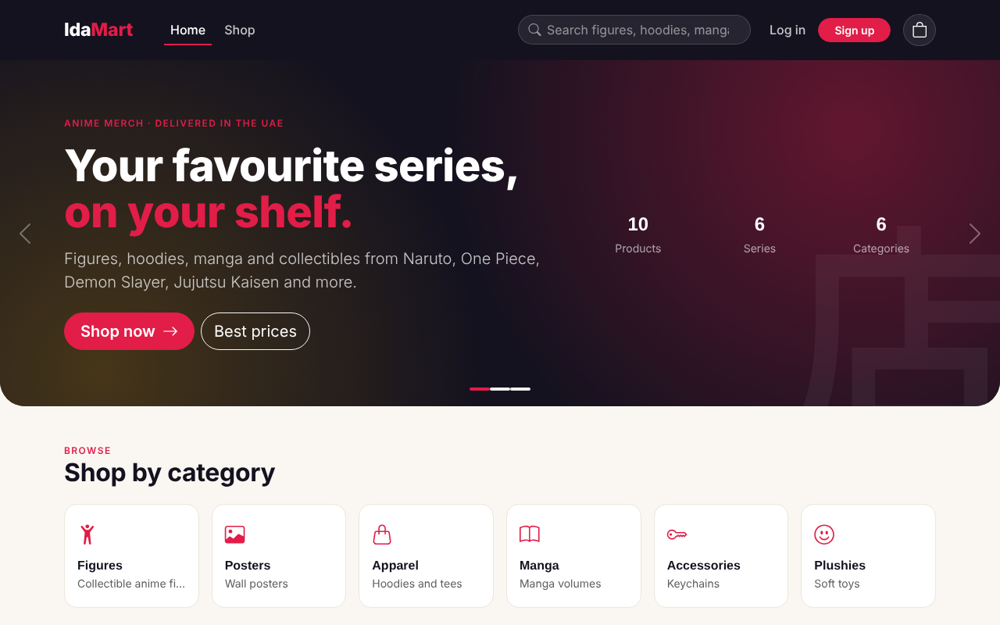
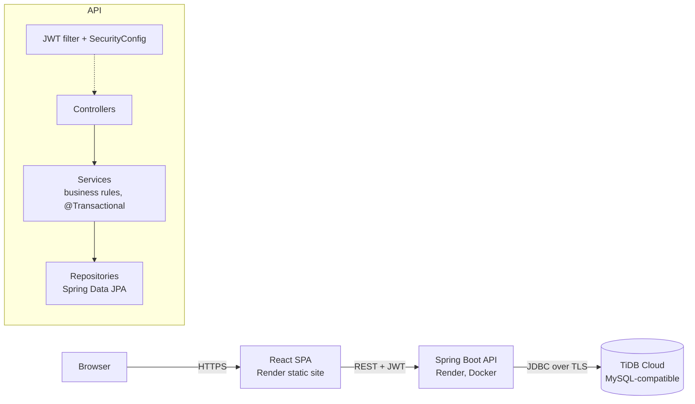
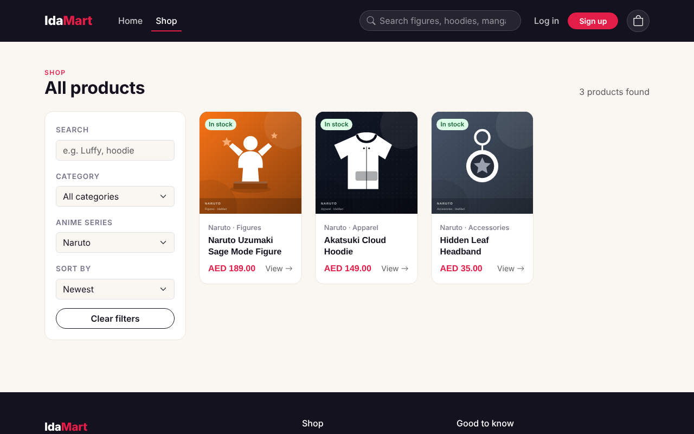
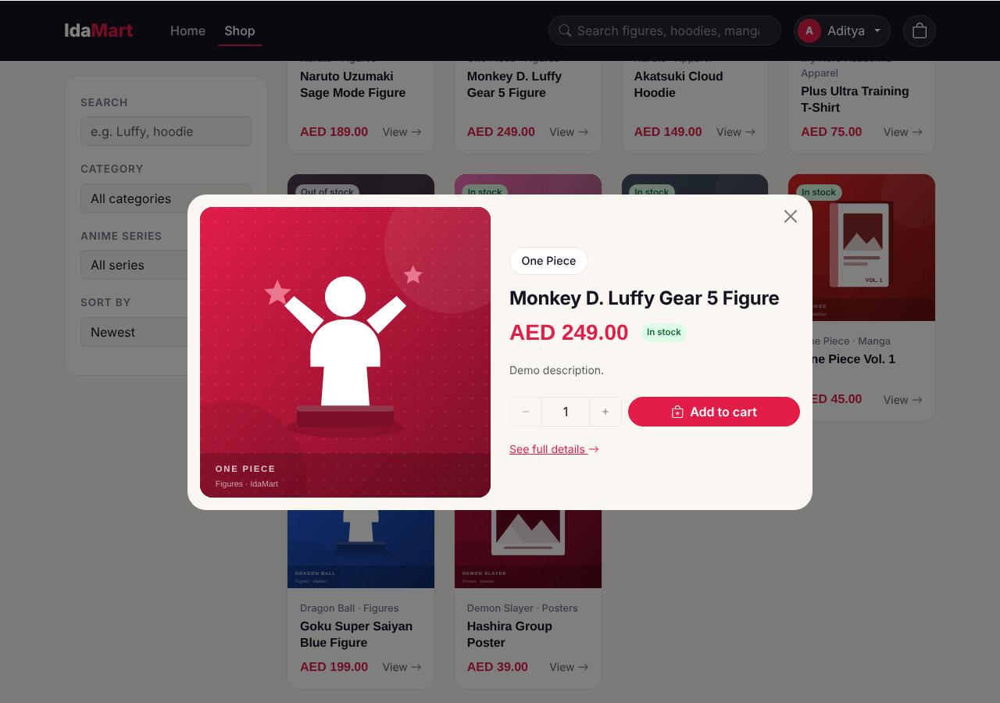
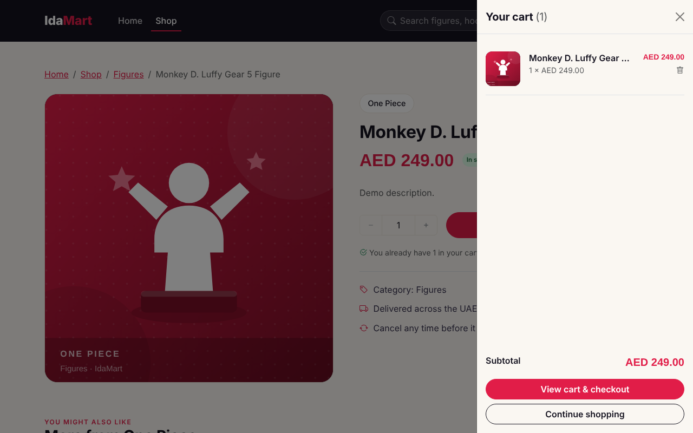
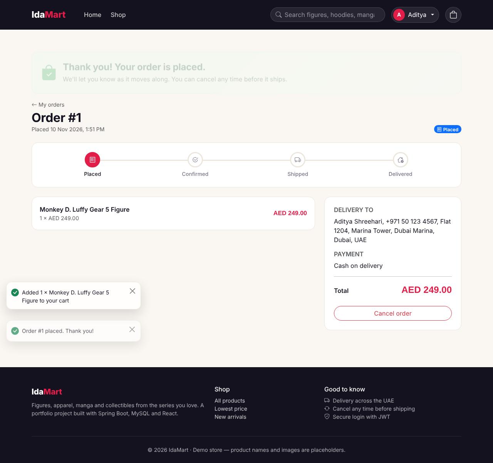
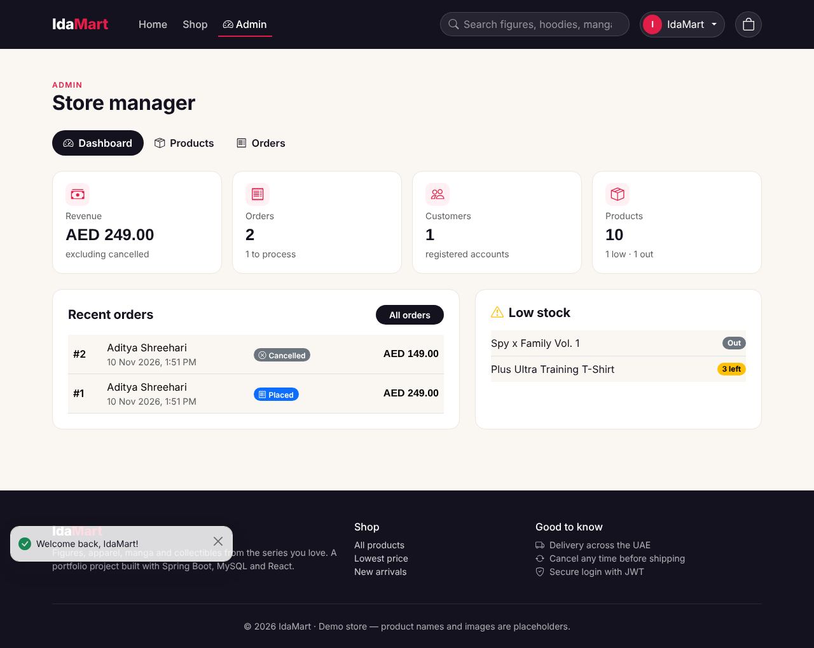
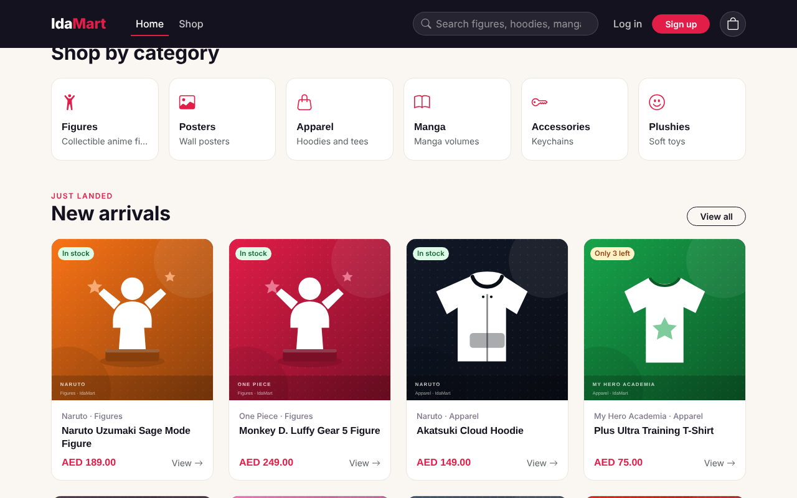

# IdaMart: anime merchandise e-commerce store

A full-stack online shop for anime figures, apparel, manga and collectibles: customers browse, sign up, fill a cart and place orders; an admin manages products and moves orders from *placed* to *delivered*.

**Live demo:** https://idamart-web.onrender.com
*(free hosting: the first visit can take up to a minute while the server wakes up)*

> Built as my full stack development training project. Product names are descriptive demo listings and all product artwork is original. No real payments are taken.



---

## Highlights

- **Spring Boot REST API** with a layered controller → service → repository design, DTOs (Java records), Bean Validation and one global JSON error format
- **JWT authentication** with Spring Security: BCrypt password hashing, stateless sessions, `CUSTOMER` / `ADMIN` roles, clean 401 vs 403 responses
- **Transactional checkout**: stock check, order creation, stock decrement and cart clearing in one all-or-nothing transaction, with **pessimistic row locking** (`SELECT … FOR UPDATE`, locks taken in id order) so the last item can never be sold twice
- **Order state machine** (`PLACED → CONFIRMED → SHIPPED → DELIVERED`, cancel before shipping) enforced inside the enum; cancelling restores stock
- **Price snapshots** in order items, **soft delete** for products, N+1 prevention with `@EntityGraph` / `JOIN FETCH` / batch fetching
- **React 19 SPA**: search, filters, sorting and pagination kept in the URL; Context-based auth and cart; Axios interceptors that attach the JWT and log out on expiry; protected routes with safe redirects
- **Admin dashboard**: live stats from aggregate SQL queries, product CRUD with validation and image preview, one-click order status changes
- **Testing at every level**: 46 JUnit 5 + Mockito unit tests, a 32-request Postman collection with assertions, a Selenium + TestNG UI suite (Page Object Model), and 45 manual test cases with bug reports

---

## Tech stack

| Layer | Technologies |
|---|---|
| Backend | Java 17, Spring Boot 3, Spring Data JPA (Hibernate), Spring Security, JJWT, Maven, Lombok |
| Database | MySQL 8 (local) · TiDB Cloud (MySQL-compatible, production) |
| Frontend | React 19, React Router, Axios, Bootstrap 5, Bootstrap Icons, Vite, HTML, CSS, JavaScript |
| Testing | JUnit 5, Mockito, AssertJ, Postman, Selenium WebDriver 4, TestNG, manual test cases (Excel) |
| Deployment | Docker (multi-stage), Render (web service + static site), GitHub |

---

## Architecture



**Database tables:** `users`, `categories`, `products`, `cart_items`, `orders`, `order_items`. Every entity extends a `BaseEntity` with an id and audit timestamps.

---

## Screenshots

| Shop with filters | Quick view |
|---|---|
|  |  |
| **Slide-out cart** | **Order tracking** |
|  |  |
| **Admin dashboard** | **New arrivals** |
|  |  |

---

## API overview

| Method | Endpoint | Access |
|---|---|---|
| POST | `/api/auth/register`, `/api/auth/login` | Public |
| GET | `/api/auth/me` | Logged in |
| GET | `/api/products?keyword=&categoryId=&anime=&sort=&page=&size=` | Public |
| GET | `/api/products/{id}`, `/api/products/anime-series`, `/api/categories` | Public |
| POST / PUT / DELETE | `/api/products/**`, `/api/categories/**` | Admin |
| GET / POST / PUT / DELETE | `/api/cart`, `/api/cart/items/{productId}` | Logged in |
| POST / GET | `/api/orders` (checkout / my orders) | Logged in |
| GET / PATCH | `/api/orders/{id}`, `/api/orders/{id}/cancel` | Owner only |
| GET / PATCH | `/api/admin/orders`, `/api/admin/orders/{id}/status`, `/api/admin/stats` | Admin |

The full collection with test assertions is in [`docs/postman`](docs/postman).

---

## Run it locally

**Needs:** JDK 17, MySQL 8, Node.js 24 LTS, Maven (bundled in Eclipse/IntelliJ).

```bash
# 1. Backend (http://localhost:8080). Creates the database, tables, admin account and 20 demo products
cd backend
mvn spring-boot:run          # MySQL user/password default to root/root; override with DB_USERNAME / DB_PASSWORD

# 2. Website (http://localhost:5173)
cd frontend
npm install
npm run dev
```

Local admin login: `admin@idamart.com` / `Admin@12345` (production uses a different password, set by an environment variable).

---

## Tests

```bash
cd backend && mvn test                              # 46 unit tests, no database needed
cd automation-tests && mvn test -Dbrowser=edge      # Selenium UI suite (backend + website must be running)
```

- Postman: import `docs/postman/IdaMart.postman_collection.json` and run the collection
- Manual: `docs/testing/IdaMart-Test-Cases.xlsx` (test cases, summary and bug reports)

---

## Deployment

Database on **TiDB Cloud Starter**, API and website on **Render** via [`render.yaml`](render.yaml). Step-by-step guide: [`docs/DEPLOYMENT.md`](docs/DEPLOYMENT.md).

---

## Project structure

```
idamart/
├── backend/            Spring Boot API (entity, repository, service, controller, security, config, dto)
├── frontend/           React + Vite website (pages, components, context, api, hooks)
├── automation-tests/   Selenium + TestNG UI tests (Page Object Model)
├── docs/               Postman collection, manual test cases, deployment guide, screenshots
└── render.yaml         Render deployment blueprint
```

---

## Author

**Aditya Shreehari Banada** · [GitHub](https://github.com/adityashreehari)
